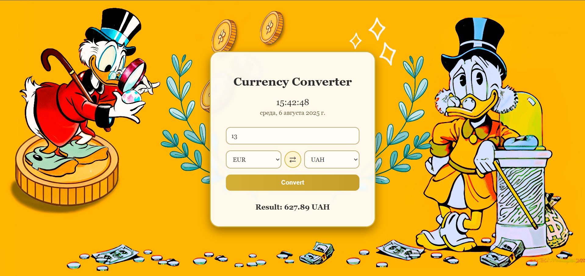

# Currency Converter

A responsive, vintage-inspired currency converter built using **HTML, CSS, and vanilla JavaScript**.

[Source code](https://github.com/Artur-Zuiev/currency-converter)



## Features

- Currency conversion using rates from `open.er-api.com`
- Choose between EUR, USD, GBP, UAH, and JPY
- Swap the source and destination currencies
- Validate user input and report request errors
- Local date and live clock
- Responsive layout with a classic, finance-inspired visual design

## Tech stack

- HTML5 and CSS3
- Vanilla JavaScript
- ExchangeRate-API public endpoint (`open.er-api.com`)

## Run locally

```bash
git clone https://github.com/Artur-Zuiev/currency-converter.git
cd currency-converter
```

Open `index.html` in a browser, or serve the directory with VS Code Live Server.

An internet connection is needed to retrieve exchange rates. Rates come from the external provider and should not be assumed to be executable market quotes.

## What this project demonstrates

Working with asynchronous APIs, input validation, DOM updates, basic error states, and responsive UI design.

**Created by [Artur Zuiev](https://github.com/Artur-Zuiev).**
